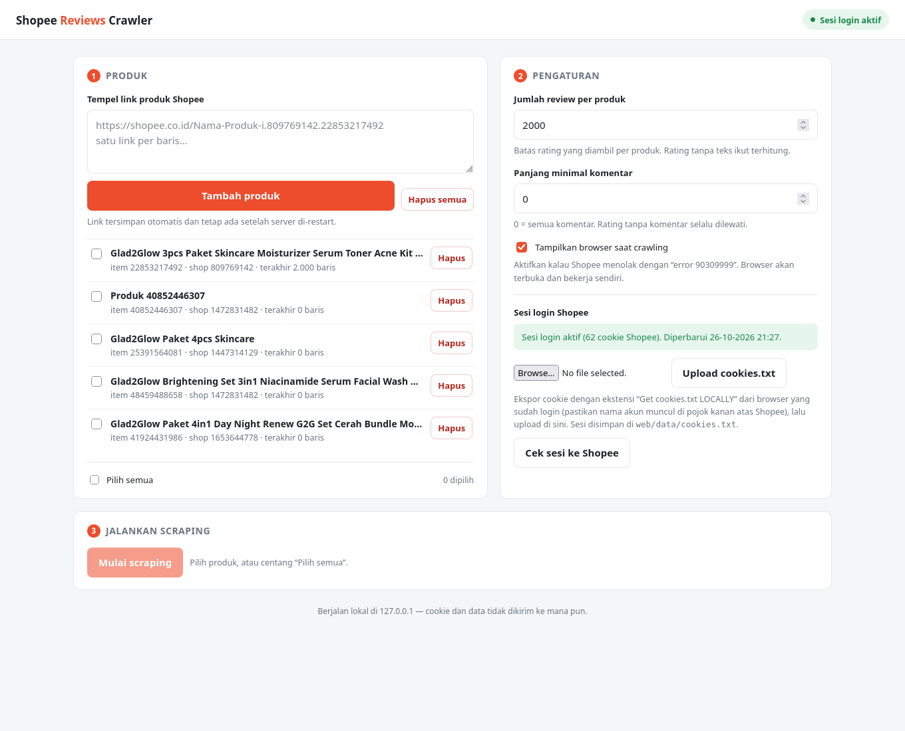

# Shopee Reviews Crawler

Crawler ulasan produk Shopee. Data diambil dari API internal Shopee
(`/api/v2/item/get_ratings`), bukan scraping HTML.

Untuk mengganti negara, ubah `country_code` di `crawler/config.yml`
(`id`, `vn`, `sg`, `my`, `th`, `ph`, `tw`, `br`). Domain diturunkan otomatis
(mis. `id` → `shopee.co.id`).

## Struktur proyek

```
shopee-reviews-crawler/
├── browser_crawl.mjs         # crawler lewat browser (Playwright Firefox)
├── crawler/                  # pustaka Python
│   ├── api.py                # sesi login + request ke API Shopee
│   ├── collector.py          # loop produk & halaman rating
│   ├── parser.py             # normalisasi satu review
│   ├── utils.py              # config, writer CSV, helper
│   ├── cli.py                # CLI: python -m crawler.cli
│   ├── importer.py           # JSON hasil browser → CSV
│   └── config.yml            # country_code: id / vn / sg / ...
├── web/
│   ├── app.py                # backend Flask + REST API
│   ├── templates/            # halaman UI (index.html)
│   └── data/                 # state.json + cookies.txt (tidak di-commit)
├── outputs/                  # hasil crawl (tidak di-commit)
├── run_web.sh                # launcher Linux / macOS
├── run_web.bat               # launcher Windows
├── requirements.txt          # dependensi Python inti
├── requirements-optional.txt # pandas (opsional)
├── package.json              # dependensi Node: playwright-core
└── glad2glow_reviews.csv     # contoh hasil 3 produk (3.036 baris)
```

## Cara termudah: antarmuka web

**Windows:**

```bat
run_web.bat
```

**Linux / macOS:**

```bash
./run_web.sh
```

Lalu buka **http://127.0.0.1:5000**. Launcher otomatis membuat `.venv`,
memasang `requirements.txt`, menjalankan `npm install`, dan mengunduh Firefox
Playwright kalau belum ada.



Halaman ini bisa dipakai tanpa terminal lagi:

1. **Produk** — tempel link produk Shopee (satu per baris) lalu klik
   *Tambah produk*. Daftar link **tersimpan permanen** di
   `web/data/state.json`, jadi tetap ada setelah server dimatikan.
2. **Pengaturan** — jumlah review per produk dan panjang minimal komentar.
   Nilainya juga tersimpan otomatis.
3. **Sesi login** — upload `cookies.txt` sekali; file disimpan di
   `web/data/cookies.txt` (chmod 600) dan dipakai lagi pada crawl berikutnya.
   Upload file yang tidak valid tidak akan menimpa sesi yang masih aktif.
4. **Mulai scraping** — progres per produk berjalan langsung, log bisa
   dibuka, dan hasilnya diunduh sebagai CSV lewat tombol *Unduh CSV*.

Server hanya mendengarkan di `127.0.0.1` (tidak bisa diakses dari jaringan
lain). Ganti port dengan `PORT=8080 ./run_web.sh` (Windows:
`set PORT=8080` lalu `run_web.bat`).

## Migrasi ke Windows

> **Browser harian Anda bebas** — Chrome, Edge, Firefox, apa pun. Crawler ini
> memakai **Firefox bawaan Playwright** (diunduh terpisah oleh launcher), bukan
> browser yang Anda pakai. Chrome hanya dipakai untuk mengekspor `cookies.txt`
> dari akun Shopee yang sudah login.
>
> Karena itu **jangan** memakai `npx playwright install firefox` (bisa memasang
> versi Firefox yang tidak cocok); gunakan perintah yang membaca versi
> `playwright-core` di proyek: `node node_modules/playwright-core/cli.js install firefox`.

Prasyarat (sekali saja):

| Perangkat | Versi | Catatan |
| --- | --- | --- |
| Python | 3.10+ | [python.org/downloads](https://www.python.org/downloads/) — centang **Add python.exe to PATH** |
| Node.js | 18 LTS+ | [nodejs.org](https://nodejs.org/) |
| Git | opsional | hanya kalau mau clone repo |

Langkah:

```bat
REM taruh folder di path pendek, mis. C:\shopee-reviews-crawler
cd C:\shopee-reviews-crawler

REM 1. jalankan UI (semua dependensi dipasang otomatis)
run_web.bat
```

Buka **http://127.0.0.1:5000**. Kalau ingin manual:

```bat
py -3 -m venv --system-site-packages .venv
.venv\Scripts\python.exe -m pip install -r requirements.txt
npm install
node node_modules/playwright-core/cli.js install firefox
.venv\Scripts\python.exe -m web.app
```

**Membawa data dari Linux:** salin folder `web\data\` (`state.json` = daftar
produk + pengaturan, `cookies.txt` = sesi login) dan file CSV hasil crawl.
Kalau tidak disalin, cukup upload `cookies.txt` lagi dan tambahkan link produk —
semuanya akan tersimpan permanen seperti sebelumnya.

Catatan Windows:

- `requirements.txt` hanya berisi 4 paket inti; semuanya punya wheel Windows.
  `pandas` dipisah ke `requirements-optional.txt` karena hanya dipakai fungsi
  `crawler.utils.read_csv()` yang tidak dipakai web UI.
- Playwright mengunduh Firefox (±90 MB) ke
  `%USERPROFILE%\AppData\Local\ms-playwright`.
- Hindari folder di dalam OneDrive atau path sangat panjang; letakkan di
  `C:\shopee-reviews-crawler` agar tidak ada masalah izin/path.
- Kalau `run_web.bat` menutup sendiri, jalankan dari Command Prompt supaya pesan
  errornya terlihat.
- Node/Playwright dicek otomatis sebelum crawl; kalau belum siap, UI menampilkan
  perintah yang perlu dijalankan.
- `cek_sistem.bat` menampilkan versi Python/Node, status Firefox Playwright, dan
  jumlah cookie. Jalankan ini kalau ada error — hasilnya memudahkan diagnosa.

## Dependensi

Sistem Python modern menolak `pip install` global (PEP 668), jadi pakai
virtualenv. Launcher web sudah melakukannya otomatis; untuk pemakaian CLI:

```bash
python -m venv --system-site-packages .venv

# Windows
.venv\Scripts\activate
# Linux / macOS
source .venv/bin/activate

python -m pip install -r requirements.txt
python -m pip install -r requirements-optional.txt   # opsional
```

Isi `requirements.txt`: `Flask`, `requests`, `PyYAML`, `tqdm`.
Dependensi Node ada di `package.json` (`playwright-core`), dipasang dengan
`npm install`.

## Usage: URL produk → CSV

```bash
python -m crawler.cli \
  --url "https://shopee.co.id/Nama-Produk-i.809769142.22853217492" \
  --output reviews.csv \
  --max-reviews 100
```

Beberapa produk sekaligus (atau dari file, satu URL per baris):

```bash
python -m crawler.cli --url 809769142.22853217492 --url 1472831482.40852446307 \
  --urls-file daftar_produk.txt --output reviews.csv
```

Filter bintang dan panjang komentar:

```bash
python -m crawler.cli --url 809769142.22853217492 --output bintang1.csv \
  --ratings 1,2 --min-comment-len 10 --max-reviews 200
```

Mode tanpa URL (produk rekomendasi Shopee):

```bash
python -m crawler.cli --recommend 10 --output rekomendasi.csv
```

### Opsi CLI

| Opsi | Default | Keterangan |
| --- | --- | --- |
| `--url` | – | URL produk atau `shopid.itemid`, boleh diulang |
| `--urls-file` | – | file teks berisi satu URL per baris |
| `--output` | `reviews.csv` | nama file hasil |
| `--max-reviews` | `100` | maksimal review per produk |
| `--min-comment-len` | `4` | buang komentar lebih pendek dari N karakter |
| `--ratings` | semua | filter bintang, mis. `1,2` |
| `--cookies` | – | file `cookies.txt` (Netscape) atau JSON |
| `--recommend` | `0` | crawl N produk rekomendasi (tanpa `--url`) |

### Opsi importer (jalur browser)

| Opsi | Default | Keterangan |
| --- | --- | --- |
| `--min-comment-len` | `0` | buang komentar lebih pendek dari N karakter |
| `--keep-empty` | mati | ikutkan rating tanpa komentar |

Rating tanpa komentar **selalu dilewati** kecuali `--keep-empty` dipakai. Jadi
produk yang mayoritas rating-nya tanpa teks bisa menghasilkan CSV kosong —
turunkan `--min-comment-len` atau naikkan `--max-reviews`.

## Login / anti-bot

Sejak 2025 Shopee menolak (`error 90309999` / HTTP 403) request tanpa sesi
login, dan mengalihkan halaman produk ke `/verify/traffic/error`. Cookie
anonim tidak cukup. Simpan cookie dari browser yang sudah login ke file, lalu:

```bash
python -m crawler.cli --cookies cookies.txt --url ... --output reviews.csv
```

`cookies.txt` boleh berformat Netscape (hasil ekstensi "Get cookies.txt") atau
JSON `{"SPC_F": "...", "SPC_SI": "..."}`.

## Kalau API tetap menolak (`error 90309999`)

Pada sebagian akun/IP, `/api/...` menolak request walau cookie login valid,
karena Shopee mewajibkan tanda tangan SDK antifraud yang hanya dibuat di dalam
halaman produk. Untuk kasus itu pakai jalur browser:

```bash
npm install                    # sekali saja
node node_modules/playwright-core/cli.js install firefox # sekali saja

node browser_crawl.mjs --cookies cookies.txt --out raw.json --max 500 \
  "https://shopee.co.id/Nama-Produk-i.809769142.22853217492"

python -m crawler.importer raw.json reviews.csv
```

`browser_crawl.mjs` membuka halaman produk di Firefox (Playwright), menyuntikkan
cookie login, lalu memanggil `get_ratings` dari konteks halaman sehingga request
ikut ditandatangani. Skrip menunggu sampai SDK Shopee benar-benar aktif (sampai
30 detik) dan mengulang request pertama bila masih ditolak, jadi koneksi lambat
tidak langsung menghasilkan `error 90309999`. `--max` membatasi jumlah rating per
produk; naikkan untuk mengambil lebih banyak. `--headful` menampilkan jendela
browser (atau centang **Tampilkan browser saat crawling** di web UI).

Kalau semua produk tetap ditolak, job di web UI berstatus **Gagal** dengan
petunjuk — bukan "selesai 0 baris" — supaya penyebabnya jelas.

### Cek sesi (Windows vs Ubuntu)

Klik **Cek sesi ke Shopee** di kartu "Sesi login Shopee", atau jalankan:

```bash
node browser_crawl.mjs --cookies web/data/cookies.txt --diagnose 809769142.22853217492
```

Laporan menampilkan akun yang benar-benar login, IP publik, selisih jam sistem,
status SDK anti-bot, dan hasil uji `get_ratings`. Tiga penyebab yang bisa
dibedakan:

| Temuan di laporan | Arti | Solusi |
| --- | --- | --- |
| `Akun login: TIDAK terdeteksi` | cookies.txt bukan sesi login (halaman produk tetap bisa tampil tanpa login) | ekspor ulang dari Chrome yang benar-benar login, upload ulang |
| `Selisih jam: > 120 detik` | jam Windows tidak akurat sehingga tanda tangan ditolak | aktifkan **Set time automatically**, restart, ulangi |
| Akun & jam benar, `IP publik` beda dari Ubuntu, tetap `90309999`/verify | IP/VPN/proxy Windows berbeda dan sedang dicurigai Shopee | matikan VPN/proxy, coba hotspot lain, atau tunggu beberapa jam |

## Output

CSV (UTF-8) dengan kolom:

```
userid, shopid, itemid, cmtid, mtime, rating_star, comment,
product_name, shop_name, shop_rating, avg_rating, rating_count, sold
```

## Lokasi file

| Path | Isi |
| --- | --- |
| `web/data/state.json` | daftar produk + pengaturan (persisten) |
| `web/data/cookies.txt` | sesi login Shopee (persisten, chmod 600) |
| `outputs/<job>_raw.json` | hasil mentah crawl (disimpan 10 terbaru) |
| `outputs/<job>_reviews.csv` | CSV dari setiap kali scraping |
| `glad2glow_reviews.csv` | contoh hasil 3 produk (3.036 baris) |

Semua folder `web/data/` dan `outputs/` masuk `.gitignore`.

## Troubleshooting

| Gejala | Penyebab | Solusi |
| --- | --- | --- |
| `Sesi belum aktif` atau `error 90309999` | cookie kedaluwarsa / bukan akun login / SDK halaman belum siap | ekspor ulang `cookies.txt` dari browser yang sudah login, upload lagi; kalau baru crawling banyak, tunggu beberapa jam |
| `error 90309999` padahal cookie baru | Shopee menolak mode headless | centang **Tampilkan browser saat crawling** di Pengaturan, lalu ulangi; atau `set HEADFUL=1` sebelum `run_web.bat` |
| `error 90309999` hanya di Windows | bisa cookie bukan sesi login, jam meleset, atau VPN/proxy | klik **Cek sesi ke Shopee**; bandingkan akun, IP publik, dan selisih jam dengan Ubuntu |
| Halaman produk dialihkan ke `/verify/traffic/error` | IP diblokir sementara | tunggu beberapa jam, ganti jaringan, pastikan cookie login valid |
| `Node.js belum terpasang` | Node tidak ada di PATH | install Node.js LTS, buka terminal/CMD baru |
| `Dependensi Node belum ada` | `npm install` belum dijalankan | `npm install` di folder proyek |
| `Browser Firefox untuk Playwright belum terpasang` | browser belum diunduh / versinya tidak cocok | `node node_modules/playwright-core/cli.js install firefox` |
| `crawler berhenti dengan kode 1` | Firefox Playwright hilang/versi tidak cocok | jalankan `node node_modules/playwright-core/cli.js install firefox`, lalu ulangi; detail error ada di **Lihat log** |
| CSV 0 baris | semua rating tanpa komentar | `--min-comment-len 0` dan/atau `--max-reviews` lebih besar, atau `--keep-empty`; web UI menampilkan alasannya saat job **Gagal** |
| Port 5000 sudah dipakai | aplikasi lain | Windows: `set PORT=8080` lalu `run_web.bat`; Linux: `PORT=8080 ./run_web.sh` |
| Emoji / huruf Mandarin rusak di Excel | Excel tidak mendeteksi UTF-8 | buka lewat **Data → From Text/CSV** lalu pilih encoding UTF-8, atau impor via Power Query |
| `run_web.bat` langsung menutup | error tidak terlihat | jalankan dari Command Prompt, bukan klik dua kali |

Log crawl di web UI (menu **Lihat log**) menampilkan pesan error lengkap dari
Node/Python, jadi cek bagian itu lebih dulu.

## Acknowledgements

This repository is the refactored version of
[Shopee Reviews Crawler](https://github.com/quocthang0507/GetShopeeReviews).
